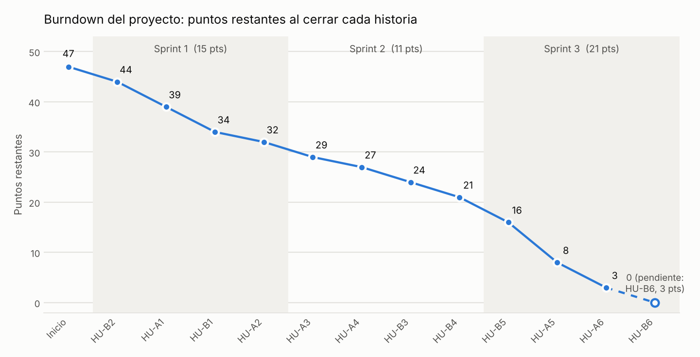

# Métricas del proyecto

Métricas de la gestión del proyecto RHControl calculadas a partir de los datos reales de GitHub (issues, Pull Requests, commits y campos del tablero de GitHub Projects). Las horas están en hora de Colombia (UTC-5).

## Resumen

| Indicador | Resultado |
|---|---|
| Historias de usuario | 12 (6 por integrante) |
| Puntos planificados | 47 (Sprint 1: 15, Sprint 2: 11, Sprint 3: 21) |
| Puntos completados al corte | 44; los 3 restantes son HU-B6, que se cierra con el Pull Request de este documento |
| Velocity promedio (Sprints 1 a 3) | 15,7 puntos por sprint (47 / 3) |
| Lead time promedio (11 historias cerradas) | 10 h 42 min |
| Cycle time promedio (11 historias cerradas) | 6 min 34 s |
| Pull Requests fusionados | 16 antes de este documento: 12 de historias o tareas y 4 releases a `production` |
| Despliegues a producción | 2 ejecuciones de `Deploy to GCP` (backend, y luego backend y frontend) |

## Definiciones

| Métrica | Cómo se calcula |
|---|---|
| Velocity | Suma de los puntos de estimación de las historias cerradas dentro de un sprint |
| Burndown | Puntos que quedan por completar después de cerrar cada historia |
| Lead time | Tiempo desde que se crea el issue hasta que se cierra |
| Cycle time | Tiempo desde el primer commit de la rama de la historia hasta que su Pull Request se fusiona |
| Throughput | Número de historias cerradas por sprint y por día |

## Velocity

| Sprint | Enfoque | Historias | Puntos planificados | Puntos completados |
|---|---|---|---|---|
| Sprint 1 | Backend y base de datos | 4 | 15 | 15 |
| Sprint 2 | Frontend | 4 | 11 | 11 |
| Sprint 3 | Despliegue y documentación | 4 | 21 | 18 al corte + 3 de HU-B6 con este PR = 21 |

La velocity de los dos primeros sprints fue de 13 puntos en promedio. El tercer sprint fue el más grande (21 puntos) porque concentró el despliegue en Google Cloud (HU-A5, 8 puntos, la historia más pesada del proyecto).

## Burndown

Puntos restantes al cerrar cada historia, en orden de cierre:

| Sprint | Inicio | Puntos restantes tras cada cierre |
|---|---|---|
| Sprint 1 | 15 | HU-B2: 12 → HU-A1: 7 → HU-B1: 2 → HU-A2: 0 |
| Sprint 2 | 11 | HU-A3: 8 → HU-A4: 6 → HU-B3: 3 → HU-B4: 0 |
| Sprint 3 | 21 | HU-B5: 16 → HU-A5: 8 → HU-A6: 3 → HU-B6: 0 (con este PR) |

## Lead time y cycle time por historia

| Historia | Sprint | Puntos | Responsable | Cierre (hora local) | Lead time | Cycle time |
|---|---|---|---|---|---|---|
| HU-B2 (#2) | 1 | 3 | Daniel | 21/10 16:18 | 39 min | 35 min |
| HU-A1 (#4) | 1 | 5 | Brayan | 21/10 16:57 | 30 min | 5 min 30 s |
| HU-B1 (#10) | 1 | 5 | Daniel | 21/10 17:05 | 33 min | 2 min 32 s |
| HU-A2 (#5) | 1 | 2 | Brayan | 21/10 17:27 | 59 min | 1 min 59 s |
| HU-A3 (#6) | 2 | 3 | Brayan | 22/10 07:59 | 15 h 32 min | 1 min 39 s |
| HU-A4 (#7) | 2 | 2 | Brayan | 22/10 08:15 | 15 h 48 min | 6 min 14 s |
| HU-B3 (#11) | 2 | 3 | Daniel | 22/10 08:25 | 15 h 53 min | 4 min 59 s |
| HU-B4 (#12) | 2 | 3 | Daniel | 22/10 08:32 | 16 h 00 min | 1 min 52 s |
| HU-B5 (#13) | 3 | 5 | Daniel | 22/10 08:44 | 16 h 13 min | 4 min 17 s |
| HU-A5 (#8) | 3 | 8 | Brayan | 22/10 10:11 | 17 h 43 min | 6 min 34 s |
| HU-A6 (#9) | 3 | 5 | Brayan | 22/10 10:23 | 17 h 56 min | 1 min 06 s |

Promedios por sprint:

| Sprint | Historias cerradas | Lead time promedio | Cycle time promedio |
|---|---|---|---|
| Sprint 1 | 4 | 40 min | 11 min |
| Sprint 2 | 4 | 15 h 48 min | 3 min 41 s |
| Sprint 3 | 3 | 17 h 17 min | 3 min 59 s |

## Throughput

| Periodo | Historias cerradas | Puntos |
|---|---|---|
| Sprint 1 | 4 | 15 |
| Sprint 2 | 4 | 11 |
| Sprint 3 (al corte) | 3 | 18 |
| 21 de octubre de 2026 | 4 | 15 |
| 22 de octubre de 2026 (al corte) | 7 | 29 |

## Participación del equipo

| Integrante | Historias asignadas | Puntos | PRs abiertos | Revisiones de PRs del compañero |
|---|---|---|---|---|
| Brayan Madera (@bdmaderam) | 6 (HU-A1 a HU-A6) | 25 | 9 | 7 (los PRs abiertos por Daniel) |
| Daniel Suárez (@Danielsuarez1-ops) | 6 (HU-B1 a HU-B6) | 22 | 7 | 9 (los PRs abiertos por Brayan) |

Ningún Pull Request se aprobó por quien lo abrió: la regla del repositorio exige al menos una aprobación de otra persona.

## Observaciones y limitaciones

- **Fechas de los sprints.** Las iteraciones del tablero están planificadas en ventanas semanales (21 de octubre, 28 de octubre y 4 de noviembre), pero el trabajo se ejecutó de forma comprimida los días 21 y 22 de octubre de 2026. Por eso el lead time de los Sprints 2 y 3 es de muchas horas: las historias se crearon juntas el 21 de octubre y esperaron su turno en el tablero.
- **Cycle time bajo.** Se mide desde el primer commit de la rama, y cada historia se desarrolló y probó localmente antes de hacer el primer commit y abrir el PR. Por eso el cycle time mide principalmente la revisión cruzada y la integración, y no incluye el tiempo de programación previo, que no queda registrado en GitHub.
- **HU-A5** fue la historia más larga en tiempo de preparación, porque incluyó crear y configurar los recursos de Google Cloud (Cloud SQL, Secret Manager, Artifact Registry y cuentas de servicio) antes de poder desplegar.
- **HU-B6** no tiene lead time ni cycle time porque se cierra con el Pull Request de este documento; sus valores no se incluyen en los promedios.
